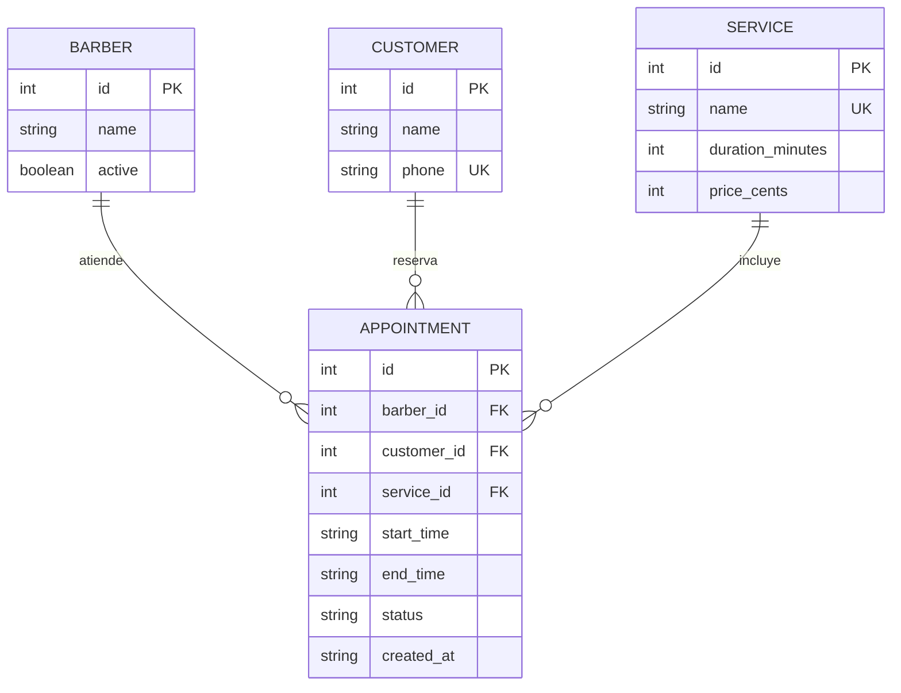

# Modelo de datos: BarberSync

> Responsable: Julio Gudiño — Architecture / Development Lead.
> Estado: propuesta de Fase 2, pendiente de validación del equipo y de los documentos de Product.
> Revisión: 17 de noviembre de 2026. Motor propuesto: SQLite.

## 1. Alcance base

Se proponen cuatro entidades: barbero, cliente, servicio y cita. Los supuestos A01–A06 de [architecture.md](architecture.md) también aplican aquí. No se afirma que estas tablas estén implementadas.



## 2. Convenciones de almacenamiento

- IDs: `INTEGER PRIMARY KEY`, generados por la base. El cliente de la API no los elige. El alcance base no incluye borrar físicamente registros ni promete IDs sin saltos.
- Claves foráneas: activar `PRAGMA foreign_keys = ON` en **cada conexión**, antes de comenzar una transacción. La declaración de una FK por sí sola no basta en SQLite.
- Horas de cita: `TEXT` en UTC canónico, de longitud fija, por ejemplo `2026-11-20T15:00:00Z`. No mezclar desplazamientos ni formatos dentro de la columna. El servicio valida y normaliza todos los valores antes de guardar; así las comparaciones textuales conservan el orden temporal.
- `created_at`: generado por el servidor en UTC con el mismo formato. La API lo transforma a Panamá igual que el resto de las fechas.
- Precio: centavos enteros en `price_cents`. La API expone `price` como cadena con dos decimales, por ejemplo `"8.00"`. No se depende de que SQLite haga cumplir una escala `DECIMAL(8,2)`.
- Un `CHECK` no reemplaza a `NOT NULL`; se utilizarán ambos donde corresponda.

## 3. Tablas propuestas

### `barbers`

| Campo | Tipo SQLite | Restricción |
|---|---|---|
| `id` | INTEGER | PRIMARY KEY. |
| `name` | TEXT | NOT NULL; nombre recortado, no vacío, de 1 a 100 caracteres. |
| `active` | INTEGER | NOT NULL; DEFAULT 1; CHECK (`active IN (0,1)`). |

### `customers`

| Campo | Tipo SQLite | Restricción |
|---|---|---|
| `id` | INTEGER | PRIMARY KEY. |
| `name` | TEXT | NOT NULL; nombre recortado, no vacío, de 1 a 100 caracteres. |
| `phone` | TEXT | NOT NULL; UNIQUE; formato canónico `+507` seguido de ocho dígitos. |

Propuesta de normalización: admitir ocho dígitos locales o prefijo `+507`, ignorando espacios y guiones. Ejemplo ficticio: `6000-0000` se guarda como `+50760000000`. Otros formatos se rechazan con 422. Product debe confirmar el alcance panameño.

Al reservar con un teléfono existente, se reutiliza el cliente y se conserva su nombre registrado; una reserva no modifica automáticamente el perfil. El teléfono es una clave de agrupación de la demo, no una prueba de identidad. No se propone un endpoint público separado para listar clientes.

### `services`

| Campo | Tipo SQLite | Restricción |
|---|---|---|
| `id` | INTEGER | PRIMARY KEY. |
| `name` | TEXT | NOT NULL; UNIQUE; texto recortado no vacío de hasta 100 caracteres. |
| `duration_minutes` | INTEGER | NOT NULL; CHECK (`duration_minutes > 0`). |
| `price_cents` | INTEGER | NOT NULL; CHECK (`price_cents >= 0`). |

### `appointments`

| Campo | Tipo SQLite | Restricción / origen |
|---|---|---|
| `id` | INTEGER | PRIMARY KEY. |
| `barber_id` | INTEGER | NOT NULL; FK a `barbers.id`, ON DELETE RESTRICT. |
| `customer_id` | INTEGER | NOT NULL; FK a `customers.id`, ON DELETE RESTRICT. |
| `service_id` | INTEGER | NOT NULL; FK a `services.id`, ON DELETE RESTRICT. |
| `start_time` | TEXT | NOT NULL; UTC canónico; validado por el servicio. |
| `end_time` | TEXT | NOT NULL; CHECK (`end_time > start_time`); calculado por el servidor. |
| `status` | TEXT | NOT NULL; DEFAULT `confirmed`; CHECK (`status IN ('confirmed','cancelled')`). |
| `created_at` | TEXT | NOT NULL; reloj del servidor, UTC canónico. |

Al crear, `end_time = start_time + duration_minutes`. Se guarda ese fin histórico; cambiar después la duración del catálogo no recalcula citas existentes. El estado inicial y `created_at` tampoco los envía el cliente.

### Índice de protección adicional

```sql
CREATE UNIQUE INDEX uq_barber_start_confirmed
ON appointments (barber_id, start_time)
WHERE status = 'confirmed';
```

El índice permite reutilizar un inicio cuando la cita anterior está cancelada. Protege únicamente inicios idénticos; el rechazo de cualquier solapamiento depende del servicio y la transacción descritos en [architecture.md](architecture.md).

## 4. Invariantes de la propuesta

1. No pueden coexistir citas confirmadas de un mismo barbero con intervalos superpuestos. Citas adyacentes y citas para distintos barberos sí se admiten.
2. El barbero debe estar activo y el servicio debe existir.
3. El inicio debe ser futuro y estar en la cuadrícula de 5 minutos del horario propuesto; toda la duración debe caber dentro de la jornada.
4. Se calcula y guarda el fin; no se acepta un fin impuesto por el cliente.
5. Crear cliente y cita forma una sola operación atómica. Si falla la reserva, no se deja un cliente nuevo huérfano como efecto de esa solicitud.
6. Cancelar modifica `status` sin borrar la fila. Las citas canceladas no bloquean disponibilidad.
7. Todos los caminos de escritura deben mantener las mismas reglas, incluidas futuras reprogramaciones.

Las reglas de horario, futuro y solapamiento requieren lógica de aplicación; no se presentan como garantías de los checks de SQLite.

## 5. Datos de demostración

Propuesta de seed idempotente, todavía por implementar:

- Dos barberos ficticios activos.
- Corte: 30 minutos, 800 centavos.
- Barba: 20 minutos, 500 centavos.
- Corte + Barba: 45 minutos, 1200 centavos.

La carga debe reutilizar registros existentes según claves estables, sin duplicarlos ni borrar citas al reiniciar. El horario común y la zona estarán en configuración, no en una tabla de horarios por barbero en esta primera propuesta.

## 6. Extensión fuera de la base

`blocked_slots` se retira del esquema base: fue una posibilidad anticipada en el borrador original. Si el equipo adopta ese requisito después, documentará la tabla, restricciones, relación con citas existentes, contrato HTTP y migración en el Issue y PR del cambio. No se considerará una sorpresa no conocida ni una capacidad ya implementada.

## 7. Fuentes técnicas

- [SQLite: tipos de datos y representación de fechas](https://www.sqlite.org/datatype3.html).
- [SQLite: activación de claves foráneas](https://www.sqlite.org/foreignkeys.html).
